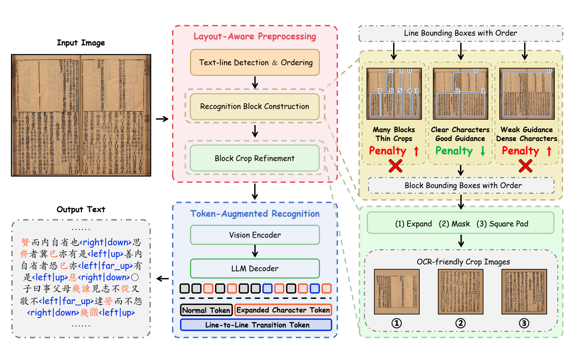

<div align="center">
  

  # TongGuOCR

  **A Layout-Aware and Token-Augmented OCR MLLM for Chinese Historical Documents**

  [Paper](https://arxiv.org/abs/2608.07917) ·
  [Project Page](https://jzzh2004.github.io/TongGuOCR) ·
  [Online Demo](https://guji-ocr.com)

  English · [简体中文](README.zh-CN.md)
</div>

## News

- **[2026-10-28]** Inference code and evaluation suite released — `tongguocr` package (layout → block → recognition), AR/CR/NED + reading-order (RO-ED) evaluation.
- Model weights are being released on Hugging Face: `jzzh2004/TongGuOCR`. If the repository is not reachable yet, check back shortly or follow the instructions in [Weights](#weights).

## Overview

TongGuOCR is a layout-aware and token-augmented multimodal large language model (MLLM) for OCR of Chinese historical documents. It is designed for pages with complex layouts, rare historical characters, and nontrivial reading orders.

The framework combines two complementary components:

- **Layout-Aware Preprocessing** constructs and refines locally coherent recognition blocks, preserving useful context while reducing interference across regions.
- **Token-Augmented Recognition** gives rare characters direct single-token representations and introduces line-to-line transition tokens to guide decoding along complex reading paths.



## Highlights

- **Layout-aware recognition blocks:** balances local context, character legibility, and reading order for complex historical pages.
- **Rare-character vocabulary expansion:** shortens the decoding path for difficult historical glyphs through direct character-level tokens.
- **Explicit transition modeling:** encodes coarse spatial displacement between text lines without requiring precise coordinates.
- **Three-stage adaptation:** progressively aligns historical-domain knowledge, high-quality supervision, and block-level inference granularity.

## Repository layout

```
tongguocr/        Python package: layout detector, block segmentation, OCR backends, CLI
evaluation/       AR/CR/NED + reading-order (RO-ED) evaluation, self-contained
tools/            Environment setup, weight download, vLLM serving, helper scripts
requirements/     Inference environment pin files
weights/          Filled by tools/download_weights.sh (not committed)
website/          Project website sources
```

## Installation

Two conda environments are needed; they cannot be merged (the layout stack pins
`mmcv-full 1.7.2` → torch 2.10 / python 3.10, while vLLM 0.32 needs torch 2.13 /
python 3.12):

```bash
bash tools/setup_env.sh        # `tongguocr`: layout + transformers OCR (default backend)
bash tools/setup_vllm_env.sh   # `tongguocr-vllm2`: vLLM serving (optional backend)
```

Notes:

- **`transformers>=5.3.0` is required** — the released weights rely on the native
  `glm_ocr` model class (no `auto_map` / remote code in the checkpoint).
- `setup_env.sh` installs or builds `mmcv-full 1.7.2` for your platform; a
  source build needs a CUDA toolkit at `CUDA_HOME` (~30–60 min).
- `setup_vllm_env.sh` picks its route automatically: NVIDIA driver ≥ 580 →
  plain PyPI `vllm==0.32.0`; driver 575.x → official `+cu129` wheels (the PyPI
  torch/vllm wheels are CUDA-13-linked and won't run there).
- **Do not use vLLM 0.18 for the GlmOcr model**: its text stack has a numeric
  bug that makes outputs diverge from the transformers backend.
- `PIP_INDEX` / `HF_ENDPOINT` can override the package index / model host (e.g.
  mirrors) if pypi.org or huggingface.co is unreachable.

## Weights

```bash
bash tools/download_weights.sh
# → weights/ocr/       full HF model dir (model.safetensors ≈ 4.7 GB + configs + tokenizer)
# → weights/layout/    layout detector checkpoint (finetune_infer.pth)
```

Set `HF_REPO_ID` to override the default repository id.

## Quickstart

```bash
conda activate tongguocr

# directory of page images → recognized plain text
python -m tongguocr --input-dir <images_dir> --output-dir <output_dir>

# single image
python -m tongguocr --image <page.jpg> --output-dir <output_dir> --print-result
```

(If the package is pip-installed, the `tongguocr` console script is equivalent
to `python -m tongguocr`.)

**vLLM backend** (faster on multi-page batches; byte-consistent with the
transformers backend):

```bash
GPU_IDS=0 bash tools/serve_vllm.sh          # in a separate shell: starts the OpenAI-compatible server
python -m tongguocr --input-dir <images_dir> --output-dir <output_dir> --ocr-backend vllm
```

All options: `python -m tongguocr --help`. Behavior is controlled by built-in
defaults (`tongguocr/config.py`) that an optional `--config user.yaml`
(YAML/JSON) deep-merges onto — a user config only needs the keys it overrides:

```yaml
ocr:
  backend: vllm
  vllm:
    api_base: http://127.0.0.1:8090/v1
```

Outputs under `<output_dir>`: per-page JSON under `pages/` (layout, blocks,
`ocr_text`), recognized plain text under `texts/`, visualizations under
`visuals/`, block crops under `block_crops/`, and a run `summary.json`.

### Reading-order tokens and newlines

During decoding the model emits line-transition relation tokens between text
lines (e.g. `<left>`, `<down>`, `<right|up>`, …; 24 tokens in total —
see `tongguocr/ocr/relation_tokens.py`). They are the model's way of expressing
reading order. **At inference time every relation token is converted to a
newline**, so the plain text in `texts/` already encodes the full reading
order, one text line per output line:

```
raw decode:  第一行文本<down>第二行文本
texts/ file: 第一行文本⏎第二行文本     (one text line per output line)
```

All other special/control tokens are stripped. The conversion is applied
identically by every backend, and the RO-ED evaluation treats it as equivalent
to the raw token stream.

## Evaluation

The evaluation suite reproduces the paper's four metrics (AR, CR, NED, RO-ED)
from a pipeline output directory. The RO-ED step has its own dependency pin
file (`evaluation/requirements_eval.txt`, torch-free):

```bash
conda activate tongguocr                       # steps 1-3 (AR/CR/NED)

# RO-ED step: torch-free env kept separate so its pinned numpy/pandas
# cannot clash with the inference stack
conda create -n tongguocr-eval python=3.10 -y
conda run -n tongguocr-eval pip install -r evaluation/requirements_eval.txt
RO_ED_PYTHON="$(conda info --base)/envs/tongguocr-eval/bin/python" \
./evaluation/run_eval.sh \
  --dataset   m5 \                             # or mthv2
  --run-dir   <pipeline output containing texts/> \
  --dataset-root /path/to/M5 \                 # or the MTHv2 root
  --output-dir <eval output dir>
```

See [evaluation/README.md](evaluation/README.md) for dataset formats, metric
definitions, options (`--skip-ro-ed`, `--match-workers`, `--limit`), and the
expected metric values from the archived runs.

## Results

TongGuOCR achieves state-of-the-art performance on two Chinese historical document OCR benchmarks.

| Benchmark | AR ↑ | CR ↑ | NED ↓ | RO-ED ↓ |
| --- | ---: | ---: | ---: | ---: |
| MTHv2 | **97.93** | **98.33** | **2.05** | **1.51** |
| M5HisDoc | **93.76** | **94.46** | **6.15** | **3.49** |

The table reproduces the paper's values. Per-backend full-benchmark runs of
this repository reproduce them closely: the two OCR backends (transformers and
vLLM) agree with each other to within 0.06 points on every metric, and each
backend's full-run values sit within 0.04 points of the tabled M5HisDoc row
(within 0.01 of the exact backend means); the MTHv2 row matches within 0.01.
Exact archived-run numbers are listed in
[evaluation/README.md](evaluation/README.md).

On the more challenging M5HisDoc benchmark, TongGuOCR reduces NED from 10.43 to 6.15 and RO-ED from 7.53 to 3.49 relative to the best competing score for each metric. See the [paper](https://arxiv.org/abs/2608.07917) and [project page](https://jzzh2004.github.io/TongGuOCR) for full comparisons, ablations, and qualitative results.

## Citation

If you find TongGuOCR useful in your research, please cite our paper:

```bibtex
@article{zhou2026tongguocr,
  title   = {TongGuOCR: A Layout-Aware and Token-Augmented OCR MLLM for Chinese Historical Documents},
  author  = {Zhou, Zhongheng and Sun, Yi and He, Huiguo and Zhang, Yuyi and Zhang, Peirong and Fang, Yulin and Peng, Dezhi and Liao, Minghui and Jin, Lianwen},
  journal = {arXiv preprint arXiv:2608.07917},
  year    = {2026}
}
```

## License

Code in this repository is released under the [Apache License 2.0](LICENSE).
Third-party attributions (OpenMMLab stack, vendored OmniDocBench) are listed
in [THIRD_PARTY_NOTICES.md](THIRD_PARTY_NOTICES.md). Model weights are
distributed separately on Hugging Face under the license stated there; the
M5HisDoc and MTHv2 datasets are not redistributed.
