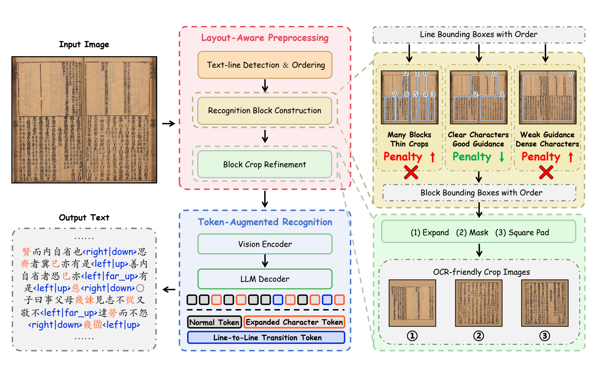

<div align="center">
  

  # TongGuOCR

  **面向中文历史文献的版面感知·词元增强 OCR 多模态大模型**

  [论文](https://arxiv.org/abs/2608.07917) ·
  [项目主页](https://jzzh2004.github.io/TongGuOCR) ·
  [在线演示](https://guji-ocr.com) ·
  [模型权重](https://huggingface.co/jzzh2004/TongGuOCR)

  [English](README.md) · 简体中文
</div>

## 📰 新闻

- **[2026-10]** 提供推理代码与评测工具。
- **[2026-08]** 论文发布于 arXiv。

## 📖 简介

TongGuOCR 是面向中文历史文献 OCR 的多模态大模型,针对复杂版面、生僻字与非平凡阅读顺序的页面。框架由两个互补组件构成:

- **版面感知预处理**:旋转文本行检测 + 动态规划分块,把文本行组织为局部连贯的识别块,保留有效上下文的同时抑制跨区域干扰;
- **词元增强识别**:生僻字获得直接的单字词元表示;行间转移词元(如 `<left|up>`)在解码时显式建模阅读顺序。

<div align="left">
  
</div>

## 📊 实验结果

| 基准 | AR ↑ | CR ↑ | NED ↓ | RO-ED ↓ |
| :--- | ---: | ---: | ---: | ---: |
| MTHv2 | **97.93** | **98.33** | **2.05** | **1.51** |
| M5HisDoc | **93.76** | **94.46** | **6.15** | **3.49** |

完整比较见[论文](https://arxiv.org/abs/2608.07917)。

## 安装

已验证的软件组合：Linux、Python 3.10、PyTorch 2.10.0（CUDA 12.8）、
Transformers 5.3.0，以及支持 bf16 的 NVIDIA GPU。安装脚本会配置这些依赖。
NVIDIA 驱动需兼容所用 CUDA 运行时；本次测试使用驱动 575.64 和 RTX A6000。
显存占用取决于图像大小和后端，目前尚未确定最低显存要求。
权重、主环境及安装文件建议预留约 20 GB 磁盘空间；可选 vLLM 环境另需空间。

```bash
git clone https://github.com/jzzh2004/TongGuOCR.git
cd TongGuOCR
bash tools/setup_env.sh
conda activate tongguocr
```

将 OCR 模型放在 `weights/ocr/`，检测权重放在
`weights/layout/finetune_infer.pth`。Hugging Face 权重地址暂为发布占位；
权重上线后可使用 `tools/download_weights.sh` 下载。

检测器使用编译后的 `mmcv-full` 扩展。安装脚本优先使用 `wheels/` 中的兼容轮子，
否则通过本地 CUDA 工具链编译，源码编译可能需要数分钟。
包下载镜像可通过 `PIP_INDEX` 设置，权重镜像可通过 `HF_ENDPOINT` 设置。

## 识别

```bash
python -m tongguocr -i <images_dir> -o output/
python -m tongguocr -i <page.jpg> -o output/ --print-result
# 可选：--limit 10、--no-visualize、--config config.yaml
```

| 输出 | 内容 |
| --- | --- |
| `texts/<page>.txt` | 识别文本；24 个 relation token 均替换为换行 |
| `pages/<page>.json` | 版面、分块、识别文本和每块原始解码 |
| `visuals/<page>.jpg` | 版面和分块可视化 |
| `block_crops/<page>/` | 送入识别器的裁剪图 |

例如，`甲乙<left|up>丙丁` 转换为 `甲乙\n丙丁`。
换行直接来自模型输出，不再按检测行数或标点重新切分文本。

### 可选 vLLM 后端

```bash
bash tools/setup_vllm_env.sh
GPU_IDS=0 bash tools/serve_vllm.sh  # 终端 1
python -m tongguocr -i <images_dir> -o output/ --backend vllm  # 终端 2
```

同一页的全部裁剪图通过一次批量请求提交，每个裁剪图对应独立会话，
由 vLLM 在服务端调度。配置和显存设置见 [vLLM 使用说明](docs/vllm.zh-CN.md)。

## 评测

```bash
python -m pip install -r evaluation/requirements_eval.txt
bash evaluation/run_eval.sh \
  --dataset m5 \
  --run-dir output/ \
  --dataset-root /path/to/M5 \
  --output-dir eval_out/m5
```

AR、CR、NED、F1、Precision、Recall、BLEU 和 RO-ED 使用同一份识别文本，
统一写入 **`eval_out/m5/metrics.json`**。MTHv2 使用 `--dataset mthv2`。
评测可直接使用推理环境，也可以使用 CPU 环境。
数据集格式和指标定义见[评测说明](evaluation/README.zh-CN.md)，数据集不随仓库分发。

## 引用

```bibtex
@article{zhou2026tongguocr,
  title   = {TongGuOCR: A Layout-Aware and Token-Augmented OCR MLLM for Chinese Historical Documents},
  author  = {Zhou, Zhongheng and Sun, Yi and He, Huiguo and Zhang, Yuyi and Zhang, Peirong and Fang, Yulin and Peng, Dezhi and Liao, Minghui and Jin, Lianwen},
  journal = {arXiv preprint arXiv:2608.07917},
  year    = {2026}
}
```

## 许可

代码使用 [Apache-2.0](LICENSE)；来源说明见[第三方声明](THIRD_PARTY_NOTICES.zh-CN.md)。
模型权重以其模型页面所列许可为准。
